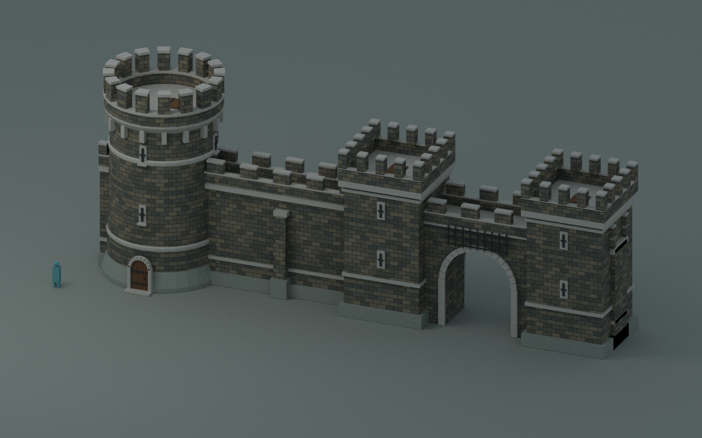
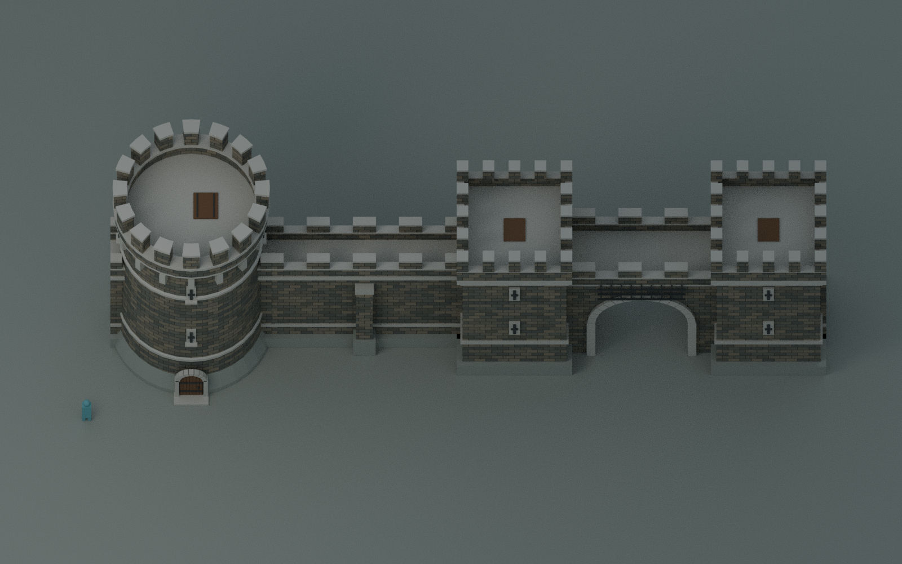
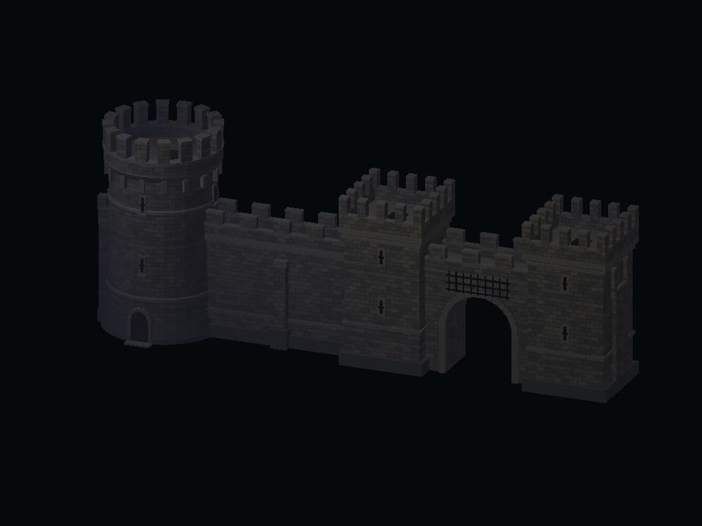

# Castle tower, modular town wall and gatehouse

Original exterior models following the windmill's pipeline: low-poly mesh,
baked masonry colour, dressed stone trim, oak and iron details, Y-up OBJ and
GLB exports, baked transforms and ground-centred origins. The GLBs refer to an
external texture URI, which Fio's renderer supports, just as the windmill does.
Their UVs are adapted to Fio's shared OBJ-style texture upload convention so
the two Fio loaders draw the masonry the same way.



## Dimensions

Authored directly in Fio units. Keep model scale **[1, 1, 1]**; no corrective
rotation is needed. A person is 100 units tall; approximate metric values use
1 unit = 1.8 cm.

| Part | Units | Approximate real size |
|---|---:|---:|
| Tower, including battlements | 768 high | 13.82 m |
| Tower plinth | 448 diameter | 8.06 m |
| Tower door leaf | 120 high | 2.16 m |
| Tower roof deck | 638 above ground | 11.48 m |
| Wall module | 512 long | 9.22 m |
| Wall, including battlements | 480 high | 8.64 m |
| Wall walkway surface | 392 above ground | 7.06 m |
| Clear width between the wall parapets | 96 | 1.73 m |
| Gatehouse | 1024 wide × 640 high | 18.43 × 11.52 m |
| Open gate passage | 256 wide | 4.61 m |
| Passage headroom at sides / arch crown | 180 / 308 | 3.24 / 5.54 m |

The tower is 3,120 triangles with six materials. The wall is 420 triangles
with three materials. The gatehouse is 2,724 triangles with six materials.
All three share the 1024×1024 `castle_stone_albedo.png`;
individual stones are painted, not separate meshes. Only one GLB node/mesh
per asset is needed, with no node transform to resolve. Back faces are culled.

## Place and repeat

1. In the Asset Browser's models, place `castle_tower.glb`, `town_wall.glb`
   or `castle_gatehouse.glb`.
   OBJ alternatives are supplied alongside them.
2. Set the position's Y to the local ground height. The tower door faces **+Z**.
3. Duplicate a wall at **+512 X** or **−512 X**, preserving Y, Z and rotation.
   Each module extends from local X = −256 to +256. Its trim stays within
   those ends; half merlons combine into a full merlon at each join.
4. For a wall rotated around Y, rotate the repeat vector by that same angle.
   A 90° Y rotation repeats along Z, at the same 512-unit spacing. Use a common
   base height on level ground; sloping ground needs stepped runs or groundwork.

All three models have flat connections along X: tower **±224**, wall **±256**,
gatehouse **±512**. The tower's masonry sockets extend to its full bounding
width at wall height, so snapping against its bounds leaves no circular gap.
The sockets share the wall's walkway and parapet heights; half merlons at
the seam join into one full merlon.

| Joining centres at scale 1, rotation 0 | X separation |
|---|---:|
| Wall → wall | 512 |
| Tower → wall | 480 |
| Gatehouse → wall | 768 |
| Tower → gatehouse | 736 |

The pictured run places the tower at **[0, 0, 0]**, the wall at **[480, 0, 0]**,
and the gatehouse at **[1248, 0, 0]**. A next wall would be **[2016, 0, 0]**.
Their join planes coincide exactly. Mirror the X offsets for a run on the
other side. The gatehouse passage runs along **Z**, through the wall line;
its iron portcullis is modelled raised, above the opening.
`assets/models/castle_kit_props.json`
contains these placement examples in the same record format as the windmill;
it is a reference, not an automatically loaded map or a new importer. Give
copies fresh entity IDs, as the editor normally does.

These are **exterior scenery**, with a closed decorative tower door and hatch.
The gatehouse has a genuine open arch and barrel passage through its mesh;
its flanking towers are solid exterior shells. There is no enterable tower
room, staircase, animated door or gameplay script.
As with the windmill, example Props have collision disabled. For a coarse
solid barrier, enable **Solid** in the Prop's properties. A model Prop's single
bounding box cannot follow the round tower, leave the wallwalk open, or
preserve the gatehouse opening. **Do not enable Solid on the gatehouse** if
you want passage through it:
use structural brushes with `nodraw` faces for precise collision and a
walkable battlement, leaving the display Prop non-solid. No active world map
or startup setting is changed by adding this kit.



## Edit and rebuild

`game/tools/data/castle_kit.blend` is the editable source, including the three
piece assembly and a 100-unit scale figure. The figure, preview ground and
lights are excluded from the shipped model exports.
`game/tools/make_castle.py` deterministically regenerates the kit with Blender
4.3 or later, without third-party art or add-ons:

```sh
blender -b -t 4 -P game/tools/make_castle.py
```

`-- --export-only` skips rendering previews. Generated presentation images
are in `work/castle`; the checked-in previews are under `docs/images`.
The machine-readable dimensions are in `assets/models/castle_kit.json`.

Validation covers both real Fio loaders, geometry/bounds parity, human-scale
door clearance, texture resolution, repeated end profiles, UV phase, all three
snap widths, and clear rays through the gate passage at human height.
`game/tests/test_castle_asset_render.py` draws a tower, wall and gatehouse
in Fio's actual forward renderer, comparing the OBJ and GLB images and checking
for GL errors. Loader tests are in `tests/miniwind/test_castle_assets.py`.


