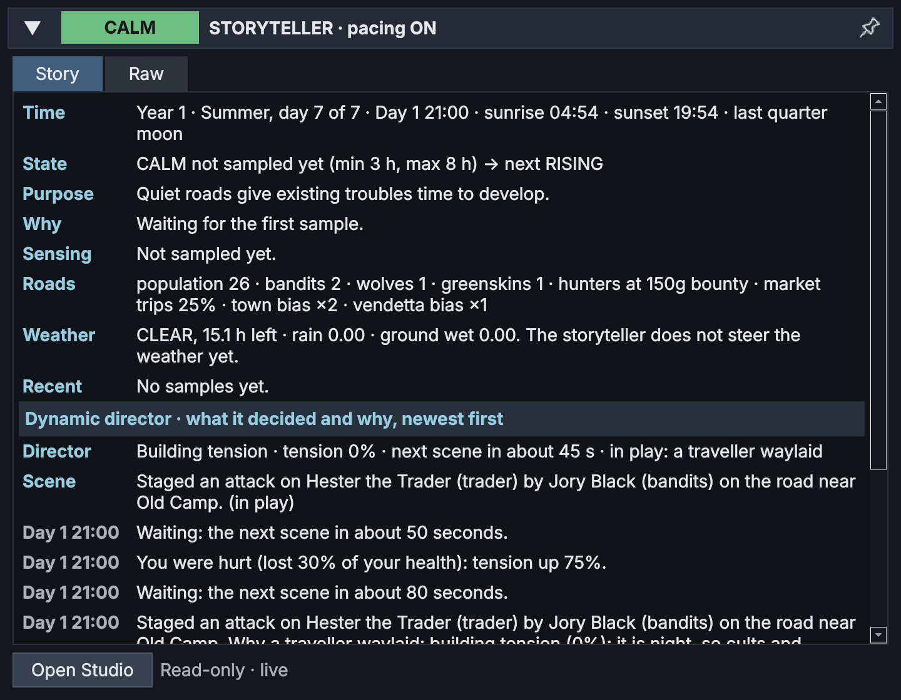
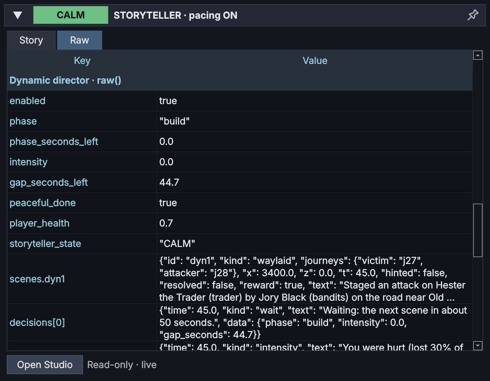
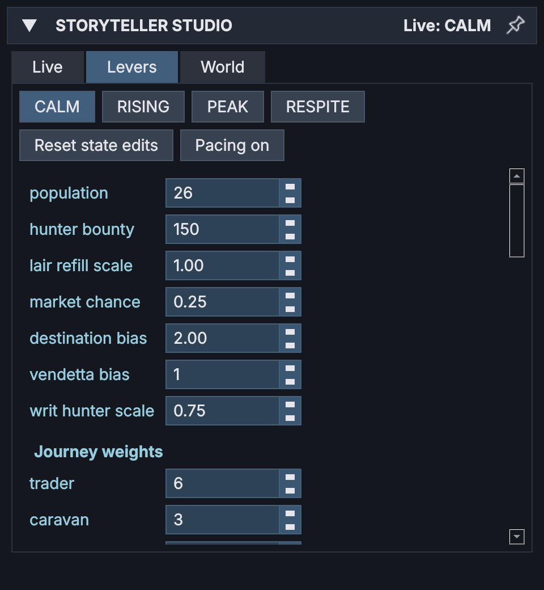

# Game modes: Normal and Dynamic

MiniWind has two game modes. They differ in one thing: **whether the
storyteller may make things happen**.

| | **Normal** (default) | **Dynamic** |
| --- | --- | --- |
| The storyteller | Paces what the world already holds. Never makes anything up. | Paces as in Normal, *and* a director authors scenes on the roads. |
| Who is on the roads | Travellers, gangs, patrols and townsfolk going about their own business. | The same people, but some are steered into your path. |
| Grudges and motives | Play out when the people who hold them get around to it. | Can be brought to you: an avenger on the road, someone come to settle a score. |
| Night | Brigands, wolves and greenskins travel after dark. | Also ambushes, cult processions and cult rites with a captive. |
| Pacing | The storyteller's CALM → RISING → PEAK → RESPITE cycle. | That cycle, plus a tension meter that reacts to what you are going through. |

Choose in **pause menu › Options › Game mode** (it is the first row). The
choice is saved as `game_mode = normal | dynamic` under `[GAME]` in
`settings.ini` and can be changed at any time, mid-game.

The full rules, with every number, are in [RULES.md §22](../RULES.md#22-game-mode).

---

## Normal mode

Normal is MiniWind as it has always played. The
[storyteller](storyteller.md) is a pacing sampler: it watches the simulation
and biases choices the world was going to make anyway -- which kind of party
sets out next, which town a trader heads for, whether a townsperson with a
real grudge happens to walk toward the town you are in. It **creates no
events, knowledge, witnesses or intentions, and cannot move or spawn
anyone.** Everything that happens to you happens because someone in the world
decided to do it, for reasons of their own.

It still explains itself in full. When it weights a trip toward you because
the traveller holds a real grudge, its activity feed says so in plain words,
naming the person, the deed and the result -- and the result is only ever
what it may do:

> The storyteller decided that Francis has a vendetta against the player
> because the player killed their brother Aldo near Ashby on day 3, which
> they saw for themselves. Result: weighted Francis's ordinary market trip
> toward Kettlewick, where the player is staying. Nothing was created:
> Francis was already setting out for market, and what they do there is up
> to them.

Nothing described below runs in Normal mode. The code for Dynamic mode only
touches journeys that Dynamic mode itself staged, so a Normal game and its
save files are exactly what they were before Dynamic mode existed.

---

## Dynamic mode

In Dynamic mode a **director** (`game/living/scenarios.py`) is allowed to
*author*. It stages scenes on the road ahead of you so that you walk into
them as if by chance: a trader being robbed as you come over the hill, a
woman sharpening a blade by the road because brigands killed her brother,
chanting in the dark where a cult holds someone from the next village.

### Authored, not invented

The director decides **when** and **where** something happens. It never
decides **who** or **why** out of thin air:

* **The people are real.** A victim is a traveller already on the roads, or a
  townsperson -- as themselves, with their own name, face, dialogue and purse
  -- taken off their schedule while nobody can see them (they are hidden at
  home while away, exactly as on a market trip). Gangs, cults and patrols
  already on the roads are borrowed before any new party is made.
* **The motives are real.** An avenger sets out only over a grievance they
  actually hold: a death, an attack or a theft by brigands, cultists or
  monsters, which they saw or were told of in the last 10 days, against them
  or someone close to them. If the very gang the culprit rides with is on the
  roads, that is the gang they find. Someone who comes to settle a score with
  *you* does so over their own intent toward you, backed by their own memory
  of what you did -- the same evidence the storyteller uses for justified
  journeys.
* **The outcome is the world's.** A scene plays out whether or not you step
  in (see [If you do nothing](#if-you-do-nothing)), and what comes of it
  feeds back into the world like anything else.

Every scene the director stages is written to the storyteller's activity feed,
so what was authored is always on the record. Each one says what was decided
and why, the memory behind it, and what the director did as a result:

> The storyteller decided that Edda wants revenge on Black Rook because Black
> Rook killed their brother Aldo near Low Farm on day 2, which they saw for
> themselves.
> **Result:** Spawned Edda (taken from Low Farm while nobody could see), armed,
> on the road 1,400 units ahead of the player, near Old Camp, and put Black
> Rook's band (the very gang the culprit rides with) 750 units beyond. Edda
> offers the player a quest ('Edda's Score'); if nobody comes within 1.5 game
> hours they go after the gang alone.

### The scenes

| Scene | When | Cast from | What you find |
| --- | --- | --- | --- |
| **Waylaid** | Any time | A peaceful traveller (trader, caravan, pilgrims, courier, minstrel, or a townsperson on a market trip) and the nearest gang | Brigands setting on the traveller. It is a real fight from the moment they come into reach. |
| **Avenger** | Any time | A townsperson with a grievance against outlaws, and the gang responsible | The townsperson, armed, by the road, telling you who did what. They offer a quest to kill the gang's leader, camped a little further on. |
| **Reckoning** | Any time | Someone with a vendetta, a reckoning or a debt to collect from *you* | Them, walking down the road toward you. A vendetta or a reckoning means a fight. |
| **Gratitude** | Any time, and in rests | Someone you healed or helped | Them, coming down the road to thank you, with a small gift from their purse. |
| **The watch** | Any time | A patrol and the nearest gang | Guards and brigands fighting on the road. |
| **Ambush** | Dusk and night | The nearest gang | Brigands lying in wait. |
| **Cult procession** | Night | A cult, from the nearest camp | Hooded figures walking the road toward you. |
| **Cult rite** | Night | A cult, and a townsperson from nearby as their captive | A rite by the road with the captive at its centre. |

As you come within 1,300 units a line on screen may hint at what is ahead --
*"Shouts carry from the road ahead."*, *"A low chanting drifts through the
dark."* An ambush only tells you the road has gone very quiet.

### Stepping in

* **Rescues.** When the attackers are dead and you come within 380 units of
  whoever they were attacking, the survivors thank you and pay a reward from
  their own purse (10--120 gold). News that you came to someone's aid spreads
  from the nearest place. A freed captive walks home.
* **Quests.** An avenger's quest is an ordinary quest in your journal, with a
  waypoint on the gang's leader; the reward is what the avenger can afford.
* **Gifts.** Someone grateful hands you a little gold when you meet.

### If you do nothing

* A robbery or a fight with the watch is settled by the board's ordinary dice
  once you are out of reach -- the gang may win, rob and kill.
* An **avenger** nobody helps waits 1.5 game hours, then goes after the gang
  alone, and lives or dies by the same dice.
* A **cult rite** nobody breaks up is finished after 2.5 game hours. The
  captive is lost: news spreads that they were taken and never came home,
  and their family hear of it as a death at the cult's hands -- a real
  grievance, which can send one of them out on the road as an avenger.
* Any other staged party waits 3 game hours, then goes back to ordinary life
  (on to where it was going, or home).

### Pacing

The director keeps a **tension meter** that follows what you are actually
going through: it rises when you are hurt (+2.5 per whole health bar lost)
and while hostiles fight within 1,500 units of you (+0.02 each per second),
and falls when things are calm (−0.04 a second; −0.01 while you are
threatened). It runs in four phases:

1. **Build** -- a scene every 45--90 seconds, until tension reaches 80%.
2. **Sustain** -- the peak plays out for 8--15 seconds.
3. **Ease off** -- nothing new until tension is below 25% and the fighting
   near you is over.
4. **Rest** -- 60--120 seconds with at most one peaceful meeting (someone
   grateful). Then build again.

A session opens with a 40-second rest. Below 45% health you get the rest
rules whatever the phase: no new threats. At most two scenes are in play at
once.

The storyteller's own state shapes it too:

| Storyteller state | Gap between scenes | Hostile scenes |
| --- | --- | --- |
| CALM | ×1.0 | ×1.0 |
| RISING | ×0.8 | ×1.3 |
| PEAK | ×0.7 | ×1.5 |
| RESPITE | ×1.6 | ×0.4 |

### Where scenes appear

Always on a road you are on (within 900 units of it), ahead of you in the
direction you are facing, between 1,150 and 1,900 units away -- beyond the
sight of every actor, so nothing appears in view -- and, for hostile scenes,
at least 900 units from any town. If there is no such spot (you are off the
roads, or the roads near you run into towns) nothing is staged until there is.

### Switching modes during play

The mode can be switched at any moment; the director reads it live.

* **Normal → Dynamic.** Nothing happens at once. The director starts with a
  40-second rest (at most one peaceful meeting), then begins building. Only
  then do scenes start to appear on the road ahead of you -- cast, as always,
  from whoever is on the roads and whatever grudges people already hold,
  including any formed while you played in Normal.
* **Dynamic → Normal.** The director stages nothing more. Staged parties that
  are out of sight go straight back to ordinary life (on to where they were
  going, or home); any you can see finish what they were doing. A quest an
  avenger gave you stays in your journal.

Each switch is written to the director's decisions and the storyteller's
activity feed.

---

## Seeing what the director decided

Type `storyteller` in the debug console (Play Mode). It opens
**Storyteller — what it's doing** in a window of its own.

* The **Story** tab is the storyteller's report in plain words. In Dynamic
  mode it has a **Dynamic director** section: what the director is doing now
  (phase, tension, time to the next scene, scenes in play) and every decision
  it took, newest first. A staged scene is three rows: the decision (who,
  what, and the memory behind it), **Result** (what it did, and where), and
  **Why now** (the phase, the hour, the storyteller's state, and every other
  scene it passed over with the reason). It also logs each time it held back
  and why, each phase change, each mode switch, and the **Outcome** of each
  scene. In Normal mode the section is not shown; the storyteller's own
  explanations are in the Activity feed in both modes.
* The **Raw** tab shows the data behind the report: the storyteller's
  `summary()` and the director's `raw()` -- tension, phase timers, every
  scene with its journey ids and position, and every decision with its
  weights, rejections and numbers.

The strip along the top of the window collapses it to just the strip (▼ / ▶)
and keeps it above other windows (the drawing pin: a leaning outline when
off, upright and filled when pinned).

**Open Studio** opens Storyteller Studio, where the storyteller's lever tables
are edited (see [storyteller.md](storyteller.md#storyteller-studio)).

The same information in the console, under the **Storyteller** category:

| Command | Does |
| --- | --- |
| `storyteller` | Opens the window. |
| `storyteller report dynamic` | Prints the director's state and its last 40 decisions. |
| `storyteller report raw` | Prints the raw data (the window's Raw tab). |
| `storyteller watch on\|off` | Logs each storyteller activity entry, and each director decision, as it happens. |

Reading any of these never samples the storyteller, appraises an actor or
draws a random number.

---

## For developers

| File | What it holds |
| --- | --- |
| `game/living/scenarios.py` | `ScenarioDirector`: pacing, casting, staging, watching scenes, the decision log, persistence. All tuning constants are at the top. |
| `game/living/journeys.py` | `DYNAMIC_KINDS` (`cultists`, `captive`, `avenger`) kept apart from `KINDS` so the ordinary board never picks, lists or tunes them; `kind_spec()` reads either. `Journey.stage`; the `stage_expired` hook. |
| `game/living/world.py` | `LivingWorld.scenarios`; holding a staged party in place, its greeting, its scene's quest, armed or aggrieved townsfolk. |
| `game/runtime.py` | `game_mode()` and `dynamic_mode_enabled()`. |
| `game/ui/options_page.py`, `game/ui/pause_actions.py` | The Options row and the setting. |
| `game/storyteller_report.py` | `dynamic_rows()` and `raw_rows()` for the window and the console. |
| `game/ui/storyteller_now.py`, `game/ui/storyteller_window.py`, `game/ui/window_strip.py` | The windows. |
| `game/tests/test_dynamic_mode.py` | Normal untouched, staging, consequences, pacing, saves, the decision log, a real-session run. |

**How a scene works.** The director never puts actors in the scene itself.
It stages *journeys* on the road board: a party held in place (`state` rest,
with `stage = {"x", "z", "scene", "role", ...}`) or walking a road it was given
(`stage["walking"]`). Journeys within reach become actors through the living
world's ordinary streaming, and from then on the engine's AI is in charge.
Parties staged to meet each other are marked as having already met, so the
board's off-screen dice don't settle them before you arrive; once a scene is
over they are released and the board's ordinary rules apply again. A
journey with `stage` set to `None` -- every journey in Normal mode -- takes
none of these code paths.

**Saves.** `Journey.to_dict()` writes `stage` only when it is set. The
director's scenes are saved under the `living.scenarios` key, and only once
it has staged something, so a Normal game's save is unchanged.

**The decision log.** `ScenarioDirector.decisions` holds the last 60 entries,
`{"time", "kind", "text", "data"}`: `text` is the plain-English sentence,
`data` the raw numbers. Kinds: `stage`, `skip` (nothing could be cast, with
each scene's reason), `wait`, `phase`, `intensity`, `world` (what became of a
scene). Repeated waits merge into one line. `listeners` receive each new
entry.
