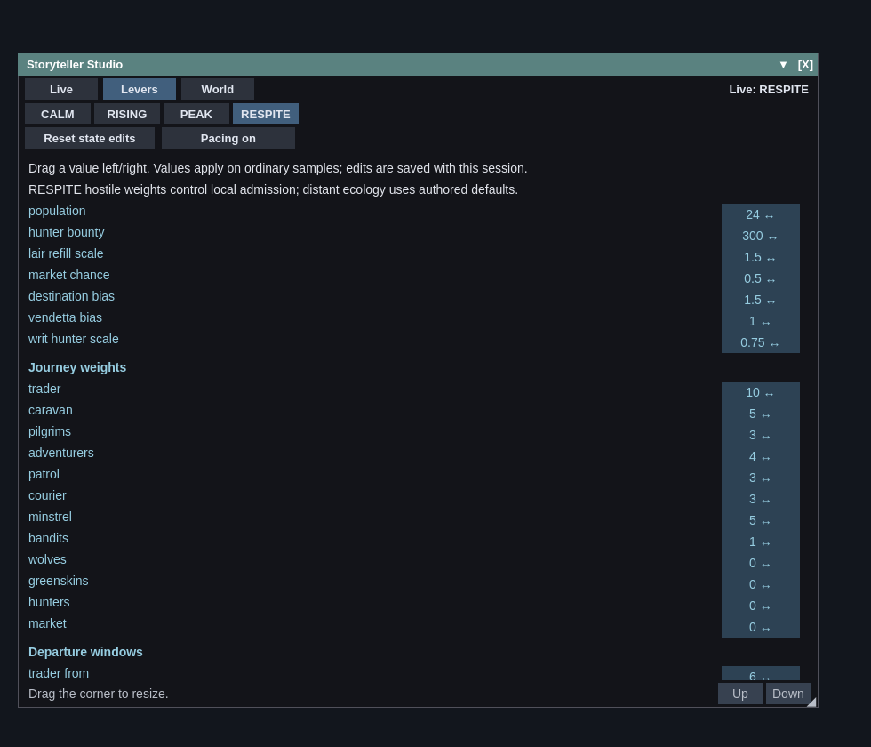
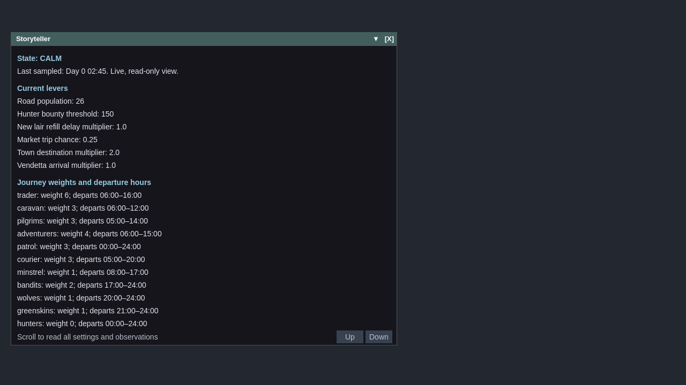
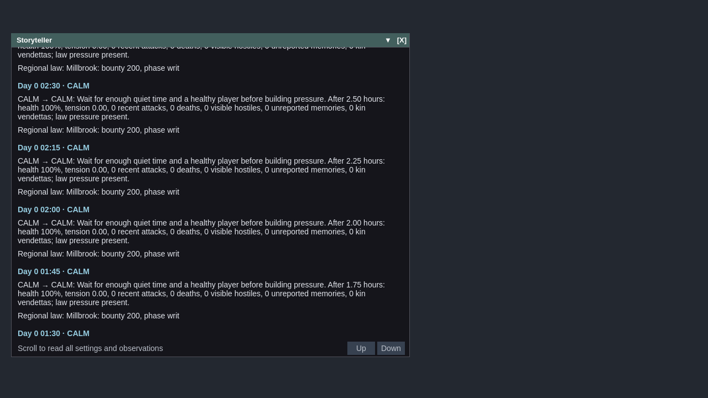

# Storyteller pacing

`game/storyteller.py` is a headless sampler over the reactive simulation. It
creates no events, knowledge, witnesses or NPC intentions. It cannot move or
spawn actors. Designer content is `game/data/storyteller.json`; a mod can
override it at `game/data/mods/<name>/storyteller.json`. `TUNING` loads that
content over `DEFAULT_TUNING` code fallbacks. Tuning lists replace rather than
append, so overriding a two-hour departure window preserves two endpoints.

The cycle is `CALM → RISING → PEAK → RESPITE → CALM`. Quiet time and recovery
gate escalation. Existing unreported memories, kin vendettas and regional writs
can start the rise; recent attacks against the player, visible hostiles and
injury measure tension. The crest is short. Respite lasts until the player has
recovered, even if recovery takes longer than an ordinary cycle.

The outcome loop reads successful hostile party materialisations recorded by
the streamer on the board, grouped by the town nearest the player. A party
counts once per successful materialisation, including a later re-entry; failed
spawns and parties already live do not count. Wolves, bandits, greenskins and
hunters count; peaceful traffic does not. This is an activation-region sensor,
not a claim that the player saw or fought every arrival. It does not increase
tension. The sampler calculates arrivals per game hour over
`arrival_window_hours` (default 2). After an empty RISING/PEAK window, road
population is capped at CALM's population until an arrival or the pressure
episode ends. Existing parties are not removed. Changing region or resetting
the board counter rebases the window. Nothing forces an arrival.

Each state supplies journey kind weights and departure windows, road population,
the hunter bounty threshold, a multiplier for new lair refill delays, market
trip probability, and destination and vendetta sampling multipliers. Windows
such as `[18, 6]` cross midnight. Unspecified journey weights/windows retain
`game/living/journeys.py`'s authored defaults. Existing travellers and NPC
intentions continue under their ordinary rules. Saved lair deadlines keep their
timing; the delay multiplier applies when a death creates a new deadline.
An unpaid writ observed continuously for `unpaid_writ_hours` (default 24)
multiplies the state's hunter bounty threshold by `writ_hunter_scale` (default
0.75). Only sampled `law_pressure` rows age it. Paying a region's debt clears
that region's sampled age; a new writ starts a fresh interval. No ledger rows
are created or changed, and this does not notify guards or supply testimony.

RESPITE's hostile weights apply to incoming journeys inside the player's live
radius, using their computed board positions. A zero suppresses that kind's
materialisation locally; raising it admits ordinary candidates again. Hunters
use RESPITE's local bounty threshold unless their weight is explicitly edited.
Distant hostile weights and hunter departures keep authored defaults, and
abstract encounters and raids continue. Already-live actors retain their AI,
routes and intentions. Relief neither retires a journey nor moves its position.

`StorytellerHooks` is a read-only interface like `WorldHooks`.
`SessionStorytellerHooks` projects the session's health, town, living knowledge
holders, visible hostile counts and existing Writs rows. Hostiles use
`world_index.counts_by_tier(predicate=...)`, filtering for visibility, liveness
and relevant tiers. Writs are read without calling methods that create records.

Although `crime.unsolved()` lists unperceived crimes too, the sampler only uses
its event IDs to filter actual stored beliefs.
Remembered crimes remain loose threads after their events leave the bounded
history, until reported, settled or forgotten. Only living NPC holders contribute
loose threads. Destination weights follow
the town holding the memory, not the event's hidden location. They influence
departures, subsequent legs and local market trips; legal destinations remain
available.

Vendetta staging requires a cached, clean kin `FIGHT` intent against the player
and the corresponding identified death fact in the actor's own knowledge.
An actor who has already attacked the player for that fact is discharged from
staging. The discharge survives rolling event history and save/load. A bonus
only applies while the player is healthy inside a town and the journey's
natural position is nearby. The streamer uses that weight to prioritise its
existing live slots, preserving the journey's route and position. Resident
proxies retain the social identity that owns their knowledge while keeping
separate scene UUIDs for save overlays.

An eligible resident's ordinary market departure can also head for the town
containing the healthy player. The destination must be a legal, reachable town
and within `vendetta_trip_distance` (default 6000 world units) of home. The
existing probability, departure hours, resident-leave check and trip cap still
gate departure. The existing destination draw selects that town, consuming no
additional random numbers. The resulting journey has an ordinary route, speed
and homeward leg. Distant, dirty, forgotten, discharged or unjustified fights
keep ordinary destination sampling. Holder identities are cached once per
sample, while facts, current intentions and discharges are revalidated at use.

The session samples world time immediately before ticking the living board.
`WorldHooks` exposes the lever and sampling queries to board/streaming code.
Every decision updates a plain-English explanation shown in the existing
mental-state inspector's **Storyteller decisions** section beside ranked
intents. Explanations are bounded, with current pacing information retained.

In Play Mode, type `storyteller` to open **Storyteller Studio**, or use **Open
Storyteller Studio** in the World Simulation window's history panel. The Studio
has three tabs:

- **Live** shows the current state, latest sensor readouts, effective levers,
  decision reasons and the last ten accepted observations, newest first.
  Repeated unchanged samples remain separate observations.
- **Levers** exposes all four state tables. Select a state, then drag a numeric
  cell horizontally: five pixels per unit, or per 0.01 for probability/refill
  multipliers. Every journey weight and both departure-hour endpoints are
  editable, including inherited defaults. Bounds reject invalid values.
  Edits to the current state affect the next ordinary board/streaming query;
  edits to another state apply when it is entered. For example, raise wolves
  from 0 in RESPITE to admit nearby wolf journeys again. Feedback caps still
  apply. **Reset state edits** restores that state's saved base table. The
  pacing toggle offers pristine ecology for the session.
- **World** shows the towns holding remembered unreported crimes and their
  destination bias, clean kin vendettas and their staging explanations, and
  bounded receipts for actual sampled journeys and materialisations. Receipts
  retain holder names, known event IDs and the bias used at selection time.
  Explicit authored destinations are not attributed to a sampling bias.

Drag the bottom-right corner to resize the Studio; its table and scroll area
reflow within the viewport. Scroll with the wheel or Up/Down. Running the
command again brings the same window forward. Opening, resizing and reading it
do not pause, tick, appraise actors or consume randomness. Numeric edits change
only the storyteller's data. They are saved in the session KV snapshot, not
written into shipped content. To distribute tuning, edit the JSON or a mod
overlay. A `storyteller.state` preset is also available on the editor's KV
suggestion surface.

The **World History** tab in the World Simulation window places the same
world-level explanations beside its causal event history. Select an explanation
to highlight its source event when that event is in the displayed history.
Journey receipts describe weighted sampling, rather than claiming that a bias
guaranteed a random choice. They can trace “this trader sampled this town with
weight 4 because this holder remembers theft #17”, then the actual arrival.
They are diagnostics owned by the storyteller, never new simulation events or
consequences. The per-actor **Storyteller decisions** section remains available.

Set `enabled` to `false` in storyteller content for pristine ecology. Every
override and weight bias becomes inert, new lair delays use authored defaults,
and all storyteller sensor hooks stay idle. A saved Studio “on” preference
cannot override this content kill switch. The Studio can still display its
last sample and edit dormant tables. A same-seed day matches the ordinary
`WorldHooks` board byte for byte and leaves its RNG in the same state.

State, timing, discharge records, sampled thread evidence, observations,
reasons, base and effective levers, Studio edits, writ ages, arrival-window
samples, population caps and diagnostic receipts persist under
`storyteller.state` in the normal KV store. This is schema version 2; other
versions reset to CALM instead of guessing at missing feedback state. Board
streaming counters have their own version-1 telemetry block; older boards
start at zero, and unknown telemetry versions are ignored.
Restoration uses the saved overrides rather than recomputing them from today's
tuning table. The sampler consumes no random numbers; board choices use the
session's reseeded RNG as before. Board consumers share one detached lever
snapshot per update or seed, rather than copying the dictionary per lookup.

Run the mechanism tests with:

```sh
python -m pytest game/tests/test_storyteller.py game/tests/test_storyteller_window.py -q
FIO_HEADLESS_TIER=1 python -m pytest -m 'not qt and not gl and not benchmark'
```

## Window screenshots

The Studio capture renders the actual resizable floating window with sample
data, showing RESPITE's editable local weights:



The earlier captures below show the observation/lever content before the Studio
tabs and editing controls. They use sample simulation data.

[Current lever settings](screenshots/storyteller-levers.png) ·
[Observation history (scrolled)](screenshots/storyteller-observations.png)




