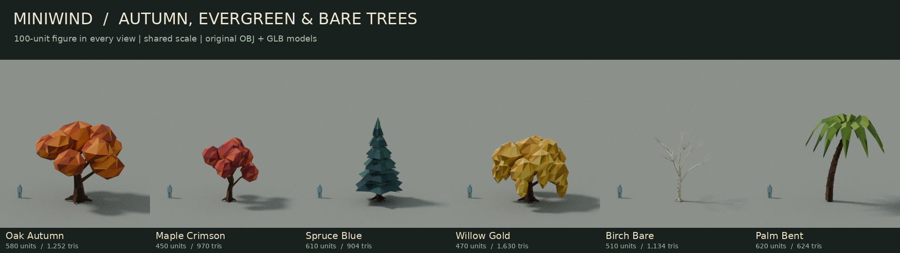
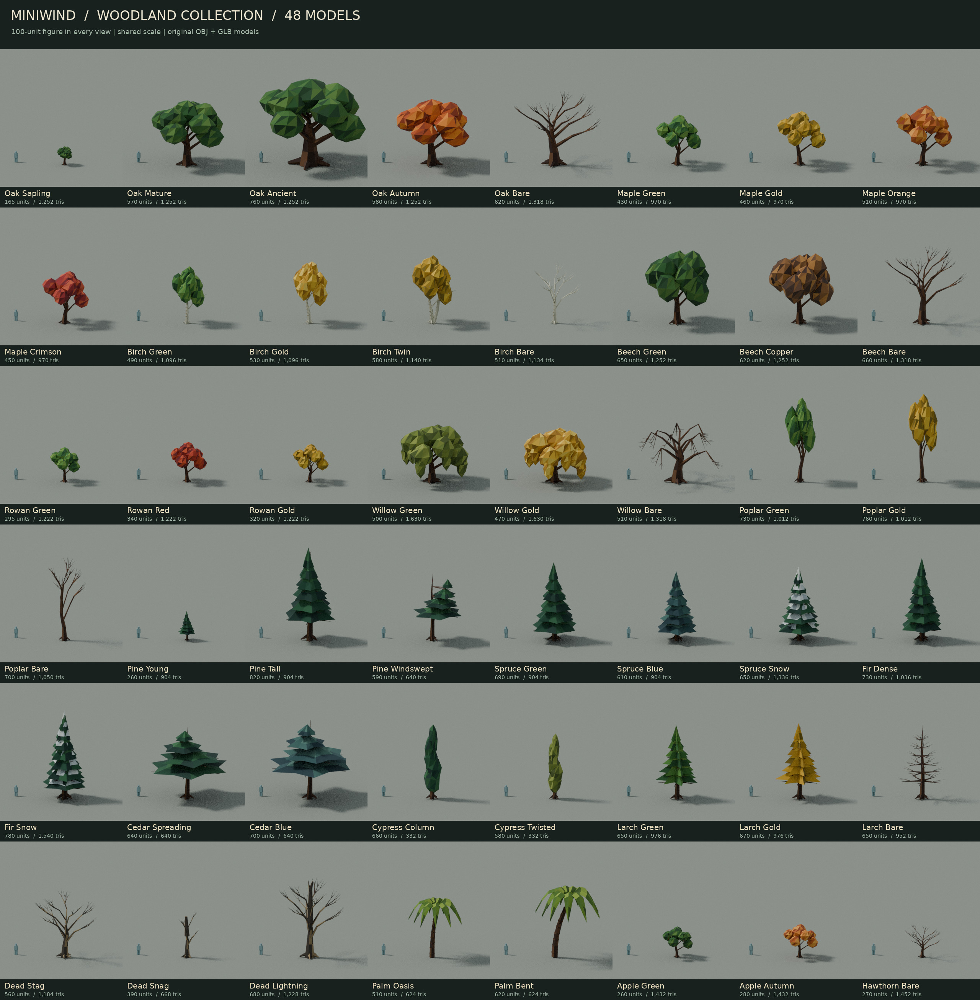

# Low-poly woodland collection

48 original tree models across 16 botanical families, with green broadleaf,
gold, amber, orange, russet, crimson and copper autumn foliage, deep evergreen,
blue-green and snow-covered conifers, palms, and ten bare winter/dead trees.
Each model has its own seeded geometry; variants change branch and crown shapes
as well as colour. These are static scenery meshes.



## Scale and placement

The existing `Tree low.obj` is 121.39 units tall, `LowPoly_Tree_v1.obj` is
204.93 units tall, and `windmill.obj` is 842.74 units tall. This collection uses
the same Fio coordinate system and the 100-unit player reference. Trees range
from a **165-unit sapling to an 820-unit pine** (about 2.97–14.76 metres at
1 unit = 1.8 cm). The catalogue uses a shared camera scale and a 100-unit person
beside every model so their relative heights remain visible.

Browse `assets/models/trees/` in the Asset Browser and place a `tree_*.glb`
or `tree_*.obj`. All models are **Y-up**, with ground-level origins at the
trunk, baked coordinates, **scale [1, 1, 1]** and **rotation [0, 0, 0]**.
Set position Y to the terrain height; rotate around Y to vary orientation.
Keep the palette PNG and MTL alongside the models when moving or exporting them.

| Family / form | Models | Colours and forms | Height, units |
|---|---:|---|---:|
| Oak | 5 | sapling, mature, ancient, russet autumn, bare | 165–760 |
| Maple | 4 | green, gold, orange, crimson | 430–510 |
| Birch | 4 | green, gold, twin trunk, bare; pale bark with dark scars | 490–580 |
| Beech | 3 | green, copper, bare | 620–660 |
| Rowan | 3 | green, red, gold; berry clusters | 295–340 |
| Willow | 3 | green, gold, bare; drooping branches | 470–510 |
| Poplar | 3 | green, gold, bare; narrow rising crowns | 700–760 |
| Pine | 3 | young, tall, windswept | 260–820 |
| Spruce | 3 | green, blue-green, snow | 610–690 |
| Fir | 2 | dense evergreen, snow | 730–780 |
| Cedar | 2 | spreading evergreen, blue-green; flat tiers | 640–700 |
| Cypress | 2 | dark column, twisted olive | 580–660 |
| Larch | 3 | green, gold autumn, bare | 650–670 |
| Dead trees | 3 | stag, broken snag, lightning-split trunk | 390–680 |
| Palm | 2 | oasis, bent trunk; folded solid fronds | 510–620 |
| Apple | 2 | green, orange autumn; fruit clusters | 260–280 |
| Hawthorn | 1 | bare branching scrub tree | 270 |

`tree_kit.json` records each model's bounds, height, triangle count, seed,
species/form and season. `tree_kit_props.json` contains 48 example Prop
records arranged in a spaced grid. It is a placement reference, not an
automatically loaded map; assign fresh IDs to duplicates.

Props use a single bounding box for collision. Leave these scenery Props
non-solid and add a narrow trunk collision brush if needed, so the canopy
does not block paths. No map, biome distribution or startup setting is changed
by installing the collection.

## Meshes and materials

**332–1,630 triangles per tree**, one mesh and one material/primitive per
model, in both OBJ and GLB. Both formats share one **256×256 palette texture**,
`tree_palette.png`, and the OBJ exports share `tree_palette.mtl`.
Foliage consists of closed, flat-shaded leaf masses, sculpted conifer tiers,
or solid folded palm fronds. There are no alpha cards or transparency sorting
requirements. Bare trees contain bark geometry and colours only.

Each triangle samples the centre of a generously padded palette swatch.
The GLBs use external image URIs and the same UV convention as the bundled
windmill/castle models, matching Fio's bottom-left texture upload path.
These are static meshes without wind animation, leaf shedding, automatic LODs
or generated collisions. Share instances of the same model for larger forests;
the collection itself does not change renderer batching behaviour.



## Rebuild and validate

`game/tools/make_tree_models.py` is the editable, deterministic source. It
uses only Python's standard library and regenerates the complete collection:

```sh
python game/tools/make_tree_models.py
```

Optional catalogue rebuild uses Blender 4.3+ and Pillow. The render script
reads the actual exported OBJ meshes back into Blender; presentation figures,
ground, camera and lights are excluded from the model files.

```sh
blender -b -t 4 -P game/tools/render_tree_models.py
python game/tools/make_tree_catalogue.py
```

If DejaVu Sans is not installed, pass `--font /path/to/a/font.ttf` to the
catalogue script. To preview only a few models, use Blender's script arguments,
for example `-- --only tree_oak_autumn tree_spruce_blue`.

`tests/miniwind/test_tree_models.py` covers all 48 exports: real Fio OBJ/GLB
loader parity for geometry, normals and UVs; ground contact, scale, material
and texture references; nondegenerate triangles and winding; single-primitive
budgets; bare-tree colours; and example placement records. All **97 checks**
passed. A separate local OpenGL smoke check drew all 48 assets through Fio's
actual GPU model classes with matching OBJ/GLB pixels and no GL errors; this
used a simple GLSL 3.3 shader on Mesa, not a complete in-game forest benchmark.

```sh
python -m pytest tests/miniwind/test_tree_models.py -q
```
